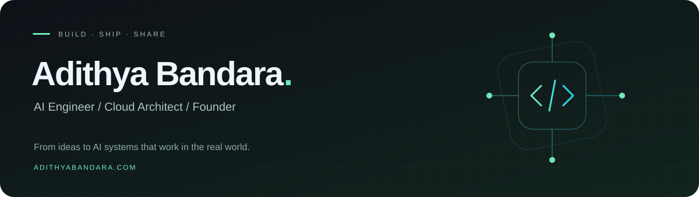

 

  
  
  

  Building AI systems and the infrastructure behind them. 
  Agentic AI &nbsp; / &nbsp; Retrieval &nbsp; / &nbsp; Speech &nbsp; / &nbsp; Cloud

 

## About

I'm Adithya — an AI Engineer and Cloud Architect who enjoys turning ideas into useful software and sharing what I learn.

- **AI Engineer** at [Avenir IT](https://avenir-it.com)
- **Founder** at [Qord IV](https://qordiv.com)
- **Part-time Lecturer** at the Institute of Digital Engineering Technology
- **Computer Science student** at the [University of Moratuwa](https://uom.lk)

 

## What I build

| Intelligent systems | Production infrastructure | Knowledge sharing |
| :--- | :--- | :--- |
| LLMs, agents, RAG, Text-to-SQL, and speech recognition | APIs, cloud systems, MLOps, and model evaluation | AI education, practical lessons, and engineering insights |

 

## Tools I work with

**Languages**

  
  
  
  

**AI & data**

  
  
  
  
  

**Backend & cloud**

  
  
  
  
  
  
  
  
  

 

## Selected projects

| Project | What it's about | Built with |
| :--- | :--- | :--- |
| **[rust-exp ↗](https://github.com/AdhiDevX369/rust-exp)** | Local LLM chatbot | `Rust` `Ollama` |
| **[MCP-S2xD ↗](https://github.com/AdhiDevX369/MCP-S2xD)** | Exploring AI and human content verification | `Go` |
| **[WetherR-Analysis ↗](https://github.com/AdhiDevX369/WetherR-Analysis)** | Climate data processing and analysis | `R` |
| **[AclNews-go ↗](https://github.com/AdhiDevX369/AclNews-go)** | News aggregation and automation | `Go` |

 

---

  <b>Have something in mind? Let's build it.</b>  
  <a href="https://adithyabandara.com">Explore my work ↗</a>
  &nbsp; · &nbsp;
  <a href="mailto:dammikaekanayaka1980@gmail.com">Get in touch ↗</a>

